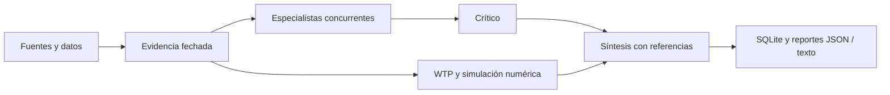

# MarketSwarm

[](https://github.com/Alain-Colombia-Arbitrage-Mev/marketswarm/actions/workflows/ci.yml)

**Evidence-driven market research and multi-agent simulations, built in Rust.**

MarketSwarm reúne evidencia, contrasta hipótesis y simula decisiones de mercado,
producto y monetización. Combina doce especialistas con un crítico y un
sintetizador, cálculos reproducibles y memoria persistente. Cada informe conserva
sus fuentes y distingue observaciones, inferencias y simulaciones.

Puedes investigar competencia y sentimiento, explorar oportunidades de producto,
comparar ofertas y estudiar **willingness to pay (disposición a pagar)** por
segmento. El módulo financiero aporta análisis de OHLCV y escenarios de
investigación. El precio recomendado, la aceptación declarada y el pago observado
se mantienen como resultados distintos.

El runtime, los conectores y las simulaciones están escritos en Rust. La
inferencia utiliza **OpenRouter**, con **`nvidia/nemotron-3.5-super-vl:free`** como modelo
predeterminado (variante gratuita) para todos los especialistas, el crítico y la síntesis, o un
servidor local compatible con chat completions. MiroFish es una referencia conceptual; el proyecto funciona sin
MiroFish, OASIS, Zep ni Python como dependencias de ejecución.

**Estado: versión inicial 0.1.0, CLI y API local.** El recorrido offline y los
contratos HTTP tienen pruebas automatizadas; también se ejecutó una investigación
real con Nemotron y publicaciones de RevenueCat/Superwall. La calidad predictiva, la WTP de
clientes y los conectores de cuentas privadas requieren validación con sus datos
reales. Consulta el [alcance completo](docs/SCOPE.es.txt) y la
[verificación](VERIFICATION.txt).



## Inicio rápido

Requisitos: Rust estable con Cargo. Los ejemplos offline no necesitan cuentas,
claves ni un modelo neuronal instalado.

```sh
git clone https://github.com/Alain-Colombia-Arbitrage-Mev/marketswarm.git
cd marketswarm
cargo build --locked
cargo run --locked -- doctor
cargo run --locked -- --db state/demo.sqlite import examples/evidence.synthetic.json
cargo run --locked -- --db state/demo.sqlite run examples/research.synthetic.json --mode offline
```

El último comando devuelve la ubicación de los reportes JSON y de texto. Los
ejemplos son datos artificiales para verificar el software. Su estudio WTP debe
seguir marcado como `inconclusive`; el modo offline no ejecuta agentes neuronales.

## Los doce módulos

| Área | Módulos |
|---|---|
| Mercados y competencia | Mercados financieros, investigación competitiva |
| Audiencia y producto | Redes sociales, sentimiento, descubrimiento de producto, recomendaciones |
| Oferta y comunicación | Contenido y reputación, pricing, willingness to pay |
| Simulación y aprendizaje | Simulación social, economía de compras, experimentación |

Los módulos se seleccionan por consulta. Los conectores permiten incorporar
documentos de **RevenueCat y Superwall**, datasets de **Apify**, búsqueda y
exportaciones propias. El adaptador de Investing necesita ajustarse al proveedor
concreto. RevenueCat y Superwall aportan referencias para apps de suscripción;
no dan acceso a compras privadas de terceros.

## Qué funciona y qué falta verificar

| Componente | Implementado | Límite actual |
|---|---|---|
| Swarm | 12 especialistas concurrentes → crítico → síntesis; selección explícita por consulta | Prueba real exploratoria; calidad semántica pendiente de evaluación sistemática |
| OpenRouter | Nemotron 3.5 Super VL predeterminado; catálogo, JSON, inferencia, reservas persistentes de coste y validación de citas | Inferencia real ejecutada; contratos válidos no garantizan conclusiones correctas |
| Inferencia local | Adaptador loopback HTTP compatible; probado con servidor de contrato | No se instaló ni ejecutó un modelo neuronal local |
| Memoria | SQLite, evidencia inmutable/versionada, tareas, eventos, resultados, grafo de citas, reanudación y exclusión mutua entre workers | No es un grafo semántico aprendido de entidades |
| Fuentes públicas | Descarga HTTPS, extracción HTML/texto y registro de fuente/fecha/hash | Tablas complejas, PDFs e imágenes requieren importación de extractos atribuidos |
| Búsqueda | Adaptador Brave; descubrimiento marcado como no leído | Requiere `BRAVE_SEARCH_API_KEY`; lectura posterior explícita con `fetch` |
| Apify | Inicio de actor con presupuesto, lectura paginada de datasets, mapeo explícito y deduplicación | Falta verificar vuestro actor, credencial, esquema y cobertura |
| Investing | Adaptador JSON genérico con bearer y parámetros separados, seguido de mapeo | Falta identificar proveedor, autenticación y esquema; no se declara una API oficial integrada |
| RevenueCat/Superwall | Lectura e investigación de publicaciones; importación de datos/exportaciones mediante contratos | Sin acceso a transacciones privadas de terceros; APIs de cuentas propias pendientes |
| WTP | Curvas por precio, intervalos Wilson, procedencia, maduración y criterios registrados | No estima WTP individual exacta ni ajusta un modelo conjoint de utilidades |
| Economía | Cohortes, renovaciones, reembolsos, cobros fallidos, impuestos, comisiones, servicio y adquisición; Monte Carlo reproducible | Tasas constantes supuestas; no se interpreta como demanda probada |
| Sentimiento | Baseline léxico español/inglés por atributos y analista neuronal configurable | Baseline sin calibrar; no se acredita precisión humana |
| Mercados | OHLCV, ATR simple, volatilidad, FVG de tres velas y swings confirmados | No DOM, flujo agresor, ejecución de órdenes ni robustez de trading probados |
| Catálogo | Ajuste por presupuesto, moneda, periodo, disponibilidad y requisitos; opción no comprar | Atributos y vigencia dependen de evidencia aportada |
| Simulación social | Red de perfiles y presupuestos con influencia, rondas y semilla; escenarios neuronales cuando haya inferencia | Interacciones artificiales, no engagement real ni WTP humana |
| Evaluación | Comparación pareada de baseline/agente/swarm: Brier, log loss, calibración, accuracy y coste | Requiere resultados reservados/posteriores; no declara superioridad por sí sola |
| API local | Autenticación, importación, consulta, investigación y recuperación de informes | Escucha solo en loopback; sin interfaz gráfica ni despliegue externo |

## Ejecutar y comprobar

Desde esta carpeta:

```sh
cargo build --locked
cargo test --locked
cargo clippy --locked --all-targets -- -D warnings
cargo run --locked -- doctor
cargo run --locked -- modules
```

Demostración artificial, sin claves ni gasto de inferencia:

```sh
cargo run --locked -- --db state/demo.sqlite import examples/evidence.synthetic.json
cargo run --locked -- --db state/demo.sqlite run examples/research.synthetic.json --mode offline
```

El estado esperado es `offline_analysis_only`: se ejecutan herramientas numéricas;
los agentes figuran como `not_run_offline`. El estudio WTP permanece `inconclusive`.
Todos los datos de esa demostración son artificiales y están identificados.
Los informes se guardan en `output/<run_id>/report.json` y `report.txt` y en SQLite.

Para OpenRouter, configura `OPENROUTER_API_KEY` en un archivo local ignorado o en
el entorno del proceso. También se aceptan `OPENROUTER_KEY` y `openrouter_key`,
en ese orden de prioridad después de `OPENROUTER_API_KEY`; los valores vacíos se
omiten. `doctor` muestra si existe alguna credencial utilizable sin revelar su
contenido. `OPENROUTER_MODEL` es opcional: el valor predeterminado es
`nvidia/nemotron-3.5-super-vl:free`. Puedes cambiarlo con `--model` o con esa variable;
la opción de línea de comandos tiene prioridad. `.env.example` incluye el modelo
y deja vacías las credenciales.
La carga de un archivo es explícita; las variables existentes tienen prioridad:

```sh
cargo run --locked -- --env-file .env models
cargo run --locked -- --env-file .env --db state/demo.sqlite run examples/research.synthetic.json --mode openrouter
```

Esa última orden realiza llamadas al modelo seleccionado, con el presupuesto
del request. El modelo debe admitir JSON `response_format`. La aplicación consulta
el catálogo actual para verificar disponibilidad, capacidades y precios.
La variante `:free` figura con precio cero de entrada y salida. Se envía ese ID
exacto, sin configurar una alternativa de pago. Los límites o la falta de
disponibilidad del endpoint gratuito pueden dejar una corrida parcial.
La selección de Nemotron se verificó en el catálogo de OpenRouter. Su razonamiento
está activado por defecto en el proveedor y puede consumir parte del límite de
salida: ajusta `limits.max_output_tokens` para dejar espacio a la respuesta JSON.
Los valores predeterminados y el ejemplo reservan hasta 8192 tokens de salida y
180 segundos por etapa; la reserva no equivale al uso facturado.
`limits.reasoning_max_tokens` permite solicitar un presupuesto de razonamiento
opcional (mínimo 1024 y al menos 512 tokens restantes para salida). Su aplicación
depende del modelo/proveedor; el límite total sigue siendo `max_output_tokens`.
`limits.reasoning_enabled=false` solicita desactivar ese razonamiento interno;
el ejemplo lo usa para limitar latencia. Esto sigue ejecutando el LLM. No lo
combines con `reasoning_max_tokens`. Omite ambas opciones para usar la
configuración del proveedor o usa `true` para solicitar razonamiento.
Cuando el catálogo anuncia `structured_outputs`, se solicita un esquema JSON
estricto. El modo compatible conserva `json_object` y validación local.
SQLite guarda el contenido devuelto, ID de respuesta, uso y hash del prompt antes
de rechazar una respuesta truncada o inválida; estos registros locales permiten
auditar llamadas facturadas que no produjeron un resultado utilizable.
El adaptador actual envía texto; seleccionar un modelo VL no añade por sí solo
ingesta de imágenes o vídeo. La inferencia local sigue requiriendo `--model`.
Las reservas conservadoras se retienen después de errores o resultados inciertos;
no se reintentan POST automáticamente. El techo de precio por token se envía al
proveedor. El gasto definitivo lo determina OpenRouter; un límite de gasto en la
clave/cuenta complementa el presupuesto local. Las llamadas de Apify y búsqueda
tienen costes independientes de la reserva del swarm.

```sh
cargo run --locked -- --db state/demo.sqlite run examples/research.synthetic.json --mode local --model MODELO_INSTALADO --local-url http://127.0.0.1:11434/v1/chat/completions
```

## Investigación con fuentes reales

```sh
cargo run --locked -- fetch https://www.revenuecat.com/state-of-subscription-apps
cargo run --locked -- fetch https://superwall.com/case-studies
cargo run --locked -- fetch https://superwall.com/docs/dashboard/dashboard-campaigns/campaigns-understanding-experiment-results
cargo run --locked -- evidence
cargo run --locked -- --env-file .env search 'site:revenuecat.com subscription pricing retention'
```

`search` devuelve descubrimientos, no evidencia leída. `fetch` conserva un extracto
de hasta 70.000 caracteres, fuente efectiva, fecha de recogida y hash. La fecha de
publicación queda desconocida si no se aportó: no se inventa a partir de la fecha
de recogida. Los agentes reciben fragmentos seleccionados por relevancia léxica,
identificados como parciales. Para una tabla concreta conviene importar un
extracto pertinente con su denominador, segmento y metodología.

Crea un request con los IDs devueltos y un `as_of` posterior a su recogida.
Selecciona los módulos pertinentes y aporta oferta, categoría, país, moneda,
periodo de facturación y objetivo en `context`. Los ejemplos son contratos de
entrada, no datos que deban mezclarse con una investigación real.

Para Apify:

```sh
cargo run --locked -- --env-file .env apify-dataset ID_DATASET --mapping examples/apify.mapping.example.json --max-items 500
cargo run --locked -- --env-file .env apify-run propietario~actor --input entrada.json --max-charge-usd 2
cargo run --locked -- --env-file .env apify-status ID_RUN
```

Adapta el mapping al esquema real. Los campos usan JSON Pointer (`/text`,
`/timestamp`); `items_pointer` es `""` para un array raíz. Se requieren fechas
RFC3339 o epoch en segundos. Campos ausentes provocan error, no timestamps
inventados. El inicio de actor devuelve un run y dataset; no equivale a extracción
terminada. Tras un resultado incierto consulta Apify antes de volver a iniciarlo.

Para Investing, verifica primero que el proveedor use bearer:

```sh
cargo run --locked -- --env-file .env investing --endpoint https://PROVEEDOR/RUTA --mapping mapping.json --query parametros.json
```

El archivo de parámetros es un objeto JSON de cadenas; no incluyas credenciales
en URLs ni parámetros. Si el proveedor requiere otro método, adapta ese conector
con su documentación. `normalize` permite importar exportaciones JSON de cualquier
fuente mediante el mismo mapping; `import` recibe directamente `Evidence[]`.

## WTP y validación

`study` registra oferta, segmento, moneda, periodo, tipo de evidencia, protocolo
y respuestas por participante/precio. Los resultados separan:

- `benchmark`: referencia externa.
- `simulated`: hipótesis artificial.
- `stated`: elección declarada por participantes humanos.
- `observed`: resultado de pago de un experimento comercial.

Los fixtures con `synthetic_fixture=true` nunca adquieren validación humana,
aunque su esquema imite una encuesta o transacción. `supported_in_scope` requiere
al menos dos precios, cierre del estudio, mínimos y precisión predefinidos,
maduración y ausencia de observaciones sintéticas o parciales. Es una conclusión
sobre la curva en ese alcance, no un ganador estadístico ni validación universal.
Los intervalos son por punto. El mínimo configurable no sustituye un cálculo de
potencia para el efecto comercial buscado. Clics, depósitos y trials no se cuentan
como pagos completos de la oferta; devoluciones no cuentan como aceptación retenida.

Las respuestas `discrete_choice` se resumen descriptivamente: el ajuste conjoint
y una validación representativa de mercado siguen pendientes. Registros y
preinscripción deben contrastarse con el sistema que recogió los datos; el motor
no puede certificar que un archivo aportado representa personas reales.

`economy` usa importes en centavos, precios con impuesto indirecto incluido,
comisiones sobre bruto sin devolución de comisiones, coste de servicio por mes
y coste de adquisición por visitante. Supone cohortes iniciales sin adquisición
posterior y termina suscripciones con cobro fallido. Los cuantiles Monte Carlo
son condicionales a esos supuestos, no intervalos de confianza de la demanda.

## Persistencia, reanudación y servicio

El identificador de corrida depende del request, evidencias, modo/modelo y hash
del código del motor y sus dependencias fijadas en `Cargo.lock`. Las tareas completadas se reutilizan; una corrida parcial
puede reanudarse con el mismo comando. Las reservas previas no se borran.
Un lease evita que dos workers ejecuten la misma corrida simultáneamente; tras
una interrupción forzosa expira dentro del plazo registrado. `report RUN_ID`
recupera un resultado sin inferencia ni gasto adicional.

Los agentes reciben extractos seleccionados de cada documento largo (unos 2200
caracteres), no todo el texto almacenado. La selección usa coincidencias con la
consulta; puede omitir regiones, tablas o condiciones relevantes. Una cita prueba
que la fuente existe, no que la afirmación sea correcta: revisa métricas y
denominadores contra la fuente antes de tomar decisiones.

```sh
cargo run --locked -- --env-file .env serve --port 8787 --mode openrouter
```

Configura `SWARM_API_TOKEN` con al menos 24 caracteres. Endpoints:

- `GET /health`: estado del proceso.
- `GET /evidence` y `POST /evidence`: consulta/importación de evidencia.
- `POST /research`: request de investigación; un trabajo admitido a la vez.
- `GET /reports/{id}`: resultado persistido.

Excepto `/health`, requieren `Authorization: Bearer ...`. No se publican rutas
para iniciar actores o realizar órdenes financieras desde HTTP.

## Evaluar el valor del swarm

```sh
cargo run --locked -- evaluate examples/evaluation.synthetic.json
```

El ejemplo prueba el cálculo, no demuestra rendimiento. Para evaluar el producto
usa predicciones anteriores a resultados reales, casos pareados, población y
presupuesto comparables, conjunto reservado y control de dependencia temporal.
Las pruebas HTTP locales usan un servidor de contrato explícitamente artificial;
no se presentan como ejecución de OpenRouter o de un modelo neuronal.
La [prueba real del 19 de octubre de 2026](docs/LIVE_ANALYSIS_2026-10-19.es.txt)
documenta los intentos, los errores detectados y el alcance de la revisión.

Fuentes técnicas: [OpenRouter](https://openrouter.ai/docs/api_reference/overview),
[routing y precios](https://openrouter.ai/docs/guides/routing/provider-selection),
[datasets Apify](https://docs.apify.com/api/v2/dataset-items-get),
[ejecución de actores](https://docs.apify.com/api/v2/actors-runs-post).
Modelo seleccionado: [NVIDIA Nemotron 3.5 Super VL gratuito en OpenRouter](https://openrouter.ai/nvidia/nemotron-3.5-super-vl:free).

## Licencia

El código conserva su declaración de licencia propietaria (`LicenseRef-Proprietary`).
Las dependencias de terceros mantienen sus respectivas licencias. No se ha
seleccionado una licencia de código abierto para este repositorio.
