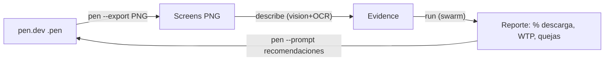

# UX swarm loop (PickFu sintético + OCR + pen.dev)

Cierra el ciclo **diseño → evidencia visual → investigación de mercado →
modificación del diseño**, combinando:

- **MarketSwarm** (motor multi-agente ya existente: 12 especialistas + crítico + síntesis, WTP).
- **Visión + OCR** (`describe` / `/vision`): un modelo visión-lenguaje "ve" las capturas
  y devuelve texto extraído + descripción visual + claridad + CTAs + precios + problemas.
- **pen.dev** como herramienta de diseño (CLI headless o MCP en vivo).
- **MCP nativo** (`mcp`): cliente MCP en Rust, para cuando se prefiere editar en vivo.



## Capacidades nuevas

| Comando / endpoint | Qué hace |
|---|---|
| `market-swarm describe archivo.png [--import]` | OCR + visión de 1-20 imágenes; con `--import` guarda el resultado como `Evidence` (`vision-…`) |
| `market-swarm mcp --command "…" --action initialize\|list-tools\|call` | Cliente MCP nativo (stdio, JSON-RPC 2.0) |
| `POST /vision` (en `serve`) | Igual que `describe`, pero por HTTP autenticado |
| `tools/orchestrator.py --backend pen\|mcp` | Orquestador del loop completo (parte A) |

## Requisitos

- Rust estable (`cargo build --locked`).
- `OPENROUTER_API_KEY` para visión y swarm en vivo (el modelo por defecto
  `nvidia/nemotron-3.5-super-vl:free` acepta imágenes y cuesta $0).
- **pen.dev CLI**: Node ≥ 22.19 y `npm install -g @pen.dev/cli`, luego `pen login`
  (o `PEN_CLI_KEY=…` para CI/CD). El backend `pen` no necesita la app de escritorio.

## Uso con pen.dev (recomendado, headless)

El CLI de pen.dev ya hace las dos puntas del loop: **exportar** la pantalla y
**modificar** el diseño con un prompt. No hace falta MCP.

```sh
# 0) una vez: autenticarse
pen login            # o export PEN_CLI_KEY=pencil_cli_...

# 1) captura: exportar el diseño a PNG
pen --in design.pen --export output/screenshot.png --export-type png --export-scale 2

# 2) visión + OCR de la captura (market-swarm)
cargo run --locked -- describe output/screenshot.png --import
#   -> { "imported": 1, "evidence_id": "vision-…", "description": {…} }

# 3) swarm (usa ese evidence_id en tu research request)
cargo run --locked -- --db state/swarm.sqlite run examples/research.synthetic.json --mode openrouter

# 4) aplicar la variante recomendada (pen.dev genera design-v2.pen)
pen --in design.pen --out design-v2.pen --prompt "<recomendaciones del swarm>"
```

### Loop completo de una línea (orquestador)

```sh
python3 tools/orchestrator.py \
  --backend pen \
  --design design.pen \
  --binary ./target/debug/market-swarm \
  --question "¿Descargarían y pagarían por esta app?" \
  --app-name "MiApp" --price-cents 799 \
  --iterations 3

# Sin red / sin credenciales, solo para ver qué comandos ejecutaría:
python3 tools/orchestrator.py --backend pen --design design.pen --question "…" --dry-run
```

Cada iteración produce `design-v1.pen`, `design-v2.pen`, … encadenando la mejora.

### Todas las pantallas (auditoría por lotes)

Para auditar las 249 pantallas de una vez (exportar → visión/OCR → reporte):

```sh
# 1) extraer cada pantalla (440x956) a un .pen individual
python3 tools/pen_extract.py \
  --in /Users/alainherrera/Mandalaapp/mandala_app/mandaladiseñoazul.pen \
  --all-screens output/screens

# 2) auditar todo el lote (requiere pen login + OPENROUTER_API_KEY)
python3 tools/run_all_screens.py --screens-dir output/screens --workers 8 --swarm
```

Genera `output/audit/report.json` y `report.csv` (por pantalla: claridad 0-10,
kind, CTAs, menciones de precio, problemas, first-impression) y, con `--swarm`,
una recomendación de producto sobre descarga/pago.

## Uso con MCP (edición en vivo en la app de escritorio)

El servidor MCP de pen.dev se habilita en **Settings → MCP** (requiere la app de
escritorio abierta con el `.pen` cargado). Herramientas: `get_style`, `read_skill`,
`get_app_state`, `execute`, `browser`, `spawn_agents` (con `-enable_spawn_agents`).

```sh
# listar herramientas del MCP server de pen.dev (native client)
cargo run --locked -- mcp \
  --command "npx -y @pen.dev/mcp-server" \
  --action list-tools

# invocar una herramienta
cargo run --locked -- mcp \
  --command "npx -y @pen.dev/mcp-server" \
  --action call --tool execute --args '{"…":"…"}'
```

Con el orquestador en modo MCP (sirve igual para Figma):

```sh
python3 tools/orchestrator.py \
  --backend mcp \
  --mcp-command "npx -y @pen.dev/mcp-server" \
  --screenshot-tool execute \
  --screenshot-args '{"…":"…"}' \
  --question "…"
```

## Contrato del endpoint `/vision`

```sh
SWARM_API_TOKEN=un-token-de-24-o-mas-caracteres \
cargo run --locked -- serve --port 8787 --mode openrouter
```

```http
POST /vision
Authorization: Bearer <SWARM_API_TOKEN>
Content-Type: application/json

{
  "prompt": "Describe esta captura…",
  "images": [
    { "mime": "image/png", "data_base64": "iVBORw0KGgo…" }
  ]
}
```

Respuesta: `{"run_id":"vision-…","description":{ "ocr_text", "visual_description",
"first_impression", "clarity_0_10", "screenshot_kind", "ctas", "price_mentions", "issues" }}`.

## Límites honestos

- La descripción visual es **sintética** (`synthetic_fixture=true`, `kind=simulated`);
  no sustituye observación humana independiente. El swarm la trata como dato, no como
  verdad de mercado.
- El cliente MCP implementa `initialize`, `tools/list` y `tools/call` (stdio). No cubre
  transporte SSE/HTTP ni `resources/*`.
- La reserva de coste y la captura de respuestas siguen las reglas existentes del motor
  (presupuesto por corrida, sin reintentos automáticos de POST).
